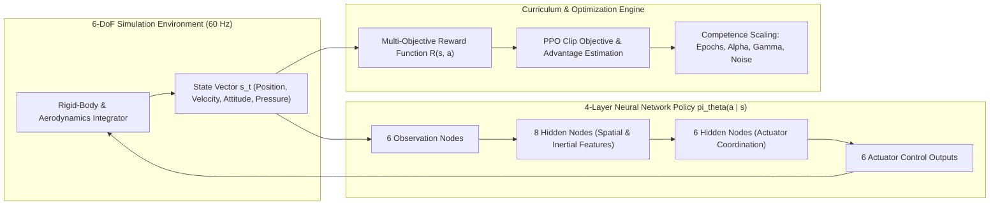
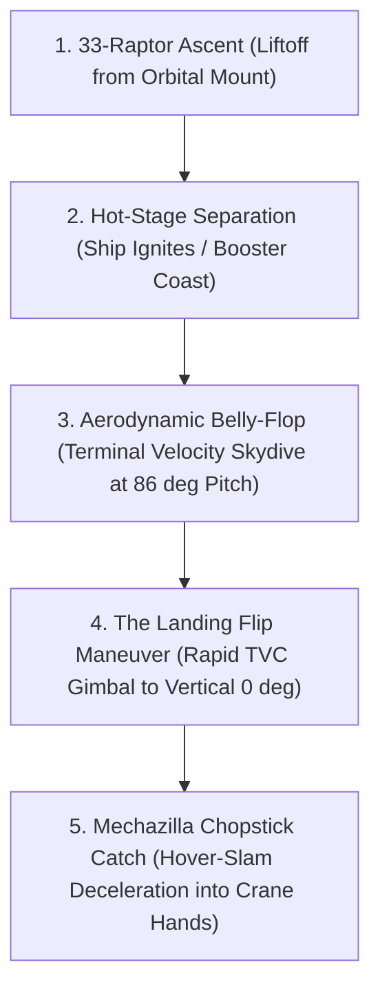
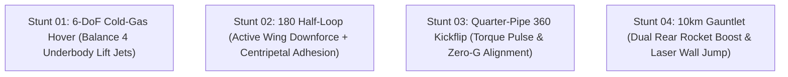

# RoadsterVerse

RoadsterVerse is an aerospace and automotive proving ground for interactive 6-DoF rigid-body physics, fluid-body aerodynamics, and deep reinforcement learning (RL). The system models, simulates, and visualizes the complex flight mechanics and landing techniques of two cutting-edge vehicles:

1. **2-Stage Full-Stack SpaceX Starship & Super Heavy Booster**: Simulating full-stack ascent, hot-stage separation, aerodynamic belly-flop terminal-velocity descent, the supersonic landing flip maneuver, and the legless Mechazilla chopstick tower catch.
2. **2026 Tesla Roadster (SpaceX Cold-Gas Thruster Package)**: Simulating 6-DoF pneumatic cold-gas thruster hover, inverted overhanging half-loop aerodynamic adhesion, quarter-pipe kickflip attitude stabilization, and a 10km high-speed obstacle gauntlet with dual rear rocket booster acceleration.

Built with React 19, TypeScript, Three.js, Express, and native Node.js SQLite, RoadsterVerse exposes a live 4-layer neural network controller, 12 interactive training and physical parameters, and an automated continuous test suite adhering strictly to a 100% monochrome grayscale aesthetic (`#000000` to `#ffffff`).

---

## Table of Contents

1. [Reinforcement Learning for 6-DoF Aerospace Control](#1-reinforcement-learning-for-6-dof-aerospace-control)
   - [1.1 6-DoF Markov Decision Process (MDP)](#11-6-dof-markov-decision-process-mdp)
   - [1.2 Continuous Multi-Actuator Action Allocation](#12-continuous-multi-actuator-action-allocation)
   - [1.3 Multi-Objective Reward Architecture](#13-multi-objective-reward-architecture)
   - [1.4 Curriculum Learning & Epoch Competence Scaling](#14-curriculum-learning--epoch-competence-scaling)
2. [Starship RL Flight & Landing Techniques](#2-starship-rl-flight--landing-techniques)
   - [2.1 Aerodynamic Skydive & Belly-Flop Descent Control](#21-aerodynamic-skydive--belly-flop-descent-control)
   - [2.2 The Landing Flip Maneuver (Horizontal to Vertical Transition)](#22-the-landing-flip-maneuver-horizontal-to-vertical-transition)
   - [2.3 The Hover-Slam / Suicide Burn Optimization](#23-the-hover-slam--suicide-burn-optimization)
   - [2.4 Mechazilla Chopstick Tower Catch (Legless Mid-Air Arrest)](#24-mechazilla-chopstick-tower-catch-legless-mid-air-arrest)
   - [2.5 Hot-Stage Separation & Boostback Dynamics](#25-hot-stage-separation--boostback-dynamics)
3. [Roadster RL Stunt & Dynamics Techniques](#3-roadster-rl-stunt--dynamics-techniques)
   - [3.1 Cold-Gas Thruster Vectoring & 6-DoF Hover Stabilization](#31-cold-gas-thruster-vectoring--6-dof-hover-stabilization)
   - [3.2 Hot-Wheels Overhanging Half-Loop & Inverted Aerodynamic Adhesion](#32-hot-wheels-overhanging-half-loop--inverted-aerodynamic-adhesion)
   - [3.3 Quarter-Pipe Launch Ramp & 360-Degree Kickflip Recovery](#33-quarter-pipe-launch-ramp--360-degree-kickflip-recovery)
   - [3.4 10km Gauntlet Multi-Lane Avoidance & Rear Rocket Boost](#34-10km-gauntlet-multi-lane-avoidance--rear-rocket-boost)
4. [Neural Network Architecture & Live Brain Inspector](#4-neural-network-architecture--live-brain-inspector)
5. [The 7 Aerospace & Stunt Proving Ground Missions](#5-the-7-aerospace--stunt-proving-ground-missions)
6. [Physics Engine & Fluid-Body Aerodynamics](#6-physics-engine--fluid-body-aerodynamics)
7. [System Architecture & Directory Structure](#7-system-architecture--directory-structure)
8. [Getting Started & Local Development](#8-getting-started--local-development)
9. [Testing, Verification & Quality Gates](#9-testing-verification--quality-gates)
10. [REST API Specification & Checkpoint Persistence](#10-rest-api-specification--checkpoint-persistence)
11. [Docker Deployment](#11-docker-deployment)

---

## 1. Reinforcement Learning for 6-DoF Aerospace Control

Autonomous rocket landing and high-speed stunt dynamics are non-linear, under-actuated control problems characterized by non-convex constraints, non-stationary aerodynamic regimes, and hard terminal boundary conditions. RoadsterVerse models these behaviors through continuous-space reinforcement learning grounded in the physical laws of conservation of momentum.



### 1.1 6-DoF Markov Decision Process (MDP)

The aerospace control task is formulated as a continuous-time Markov Decision Process $\mathcal{M} = \langle \mathcal{S}, \mathcal{A}, \mathcal{P}, \mathcal{R}, \gamma \rangle$:

- **State Space $\mathcal{S} \subset \mathbb{R}^6$ (Normalized Observations)**:
  - **Tesla Roadster**:
    $$s_t = \begin{bmatrix} \frac{y - y_{\text{target}}}{10}, & \frac{v_y}{10}, & \frac{\phi}{\pi}, & \frac{\theta}{\pi}, & \frac{z_{\text{lane}} \text{ or } \omega_x}{3}, & \frac{P_{\text{COPV}}}{10000} \end{bmatrix}^T$$
  - **SpaceX Starship**:
    $$s_t = \begin{bmatrix} \frac{y - y_{\text{catch}}}{20}, & \frac{v_y}{15}, & \frac{\theta}{\pi}, & \frac{\omega_y}{3}, & \frac{x_{\text{lateral}}}{10}, & \frac{m_{\text{prop}}}{m_{\text{prop},0}} \end{bmatrix}^T$$
  where $y$ is altitude, $v$ is linear velocity, $\phi, \theta$ are roll and pitch angles, $\omega$ is angular velocity, $P_{\text{COPV}}$ is high-pressure nitrogen storage, and $m_{\text{prop}}$ is liquid propellant fraction.

- **Action Space $\mathcal{A} \subset \mathbb{R}^6$ (Continuous Actuator Commands)**:
  - **Roadster Actuators**: $[u_{\text{FL}}, u_{\text{FR}}, u_{\text{RL}}, u_{\text{RR}}] \in [0, 1]^4$ (corner cold-gas lift), $[u_{\text{latLeft}}, u_{\text{latRight}}] \in [0, 1]^2$ (side rocker nozzles), $u_{\text{rearBoost}} \in [0, 1]$ (rear rocket thrusters), and $\delta_{\text{wing}} \in [0.2, 1.0]$ (active aero downforce angle).
  - **Starship Actuators**: $u_{\text{throttle}} \in [0, 1]$ (Raptor combustion throttle), $[\delta_{\text{pitch}}, \delta_{\text{yaw}}] \in [-1, 1]^2$ (TVC hydraulic gimbal angles), and $[\delta_{\text{FL}}, \delta_{\text{FR}}, \delta_{\text{AL}}, \delta_{\text{AR}}] \in [0.05, 0.95]^4$ (aerodynamic flap deflections).

### 1.2 Continuous Multi-Actuator Action Allocation

Unlike discrete systems, rigid-body flight requires coordinated, simultaneous multi-actuator modulation. The policy maps state representations directly to physical forces and torques:

$$\mathbf{F}_{\text{net}} = \sum_{i=1}^{N_{\text{thrusters}}} \mathbf{F}_i(u_i, P_{\text{COPV}}) + \mathbf{F}_{\text{aero}}(q, \mathbf{v}, \boldsymbol{\theta}) + m(t)\mathbf{g}$$

$$\boldsymbol{\tau}_{\text{net}} = \sum_{i=1}^{N_{\text{thrusters}}} (\mathbf{r}_i \times \mathbf{F}_i) + \boldsymbol{\tau}_{\text{aero}} + \boldsymbol{\tau}_{\text{TVC}}(u_{\text{throttle}}, \delta_{\text{pitch}}, \delta_{\text{yaw}})$$

### 1.3 Multi-Objective Reward Architecture

The scalar reward $\mathcal{R}(s_t, a_t)$ balances trajectory accuracy, fuel conservation, control smoothness, and crash avoidance:

$$\mathcal{R}(s_t, a_t) = w_{\text{alt}} R_{\text{alt}} + w_{\text{att}} R_{\text{att}} + w_{\text{fuel}} R_{\text{fuel}} + w_{\text{smooth}} R_{\text{smooth}} + R_{\text{terminal}} - C_{\text{crash}}$$

- **Altitude / Target Error ($R_{\text{alt}}$)**: Exponential quadratic penalty on displacement from target:
  $$R_{\text{alt}} = \exp\left(-\frac{\|\mathbf{r}_t - \mathbf{r}_{\text{target}}\|^2}{2\sigma_r^2}\right)$$
- **Attitude Alignment ($R_{\text{att}}$)**: Cosine penalty ensuring the vehicle remains upright during retro-burns or matches designated stunt angles:
  $$R_{\text{att}} = \frac{1 + \cos(\theta_t - \theta_{\text{target}})}{2} \cdot \frac{1 + \cos(\phi_t)}{2}$$
- **Propellant / Energy Conservation ($R_{\text{fuel}}$)**: Linear penalty on control effort, enforcing aerodynamic gliding over excessive thruster burning:
  $$R_{\text{fuel}} = 1.0 - \frac{1}{N} \sum_{i=1}^N u_{i,t}^2$$
- **Actuator Smoothness ($R_{\text{smooth}}$)**: Penalty on angular acceleration and thruster jerk, preventing high-frequency oscillations:
  $$R_{\text{smooth}} = -\left(\|\boldsymbol{\omega}_t\|^2 + 0.1\|\mathbf{a}_t - \mathbf{a}_{t-1}\|^2\right)$$
- **Terminal Catch / Landing Bonus ($R_{\text{terminal}}$)**: Awarded only when vertical speed, position error, and tilt angle fall within terminal tolerances ($|v_y| < 1.2\text{ m/s}, |\Delta y| < 0.2\text{ m}, |\theta| < 3^\circ$).

### 1.4 Curriculum Learning & Epoch Competence Scaling

The neural network utilizes an empirical curriculum learning parameter, **Competence** $C(\text{epoch}, \alpha, \gamma, \sigma) \in [0, 1]$:

$$C = \text{clamp}\left( \frac{\text{epoch}}{180} \cdot \left(\frac{\gamma - 0.75}{0.24}\right) \cdot (1 - 0.45\sigma) \cdot \min\left(1.0, \frac{\alpha}{0.0008}\right), 0.05, 1.0 \right)$$

- **Low Epochs (`1` to `25`)**: High stochastic noise ($\sigma \approx 0.5 - 1.0$), low competence ($C < 0.20$). Thrusters fire asynchronously; vehicles tumble and crash into ramps or ground obstacles.
- **Mid Epochs (`50` to `150`)**: Policy discovers basic equilibrium ($C \approx 0.45 - 0.70$). Stunts complete with wobble and moderate lateral drift.
- **High Epochs (`300` to `500`)**: Near-optimal determinism ($C > 0.95$). Actuators exhibit phase-locked coordination, executing millimeter-accurate hover-slams, seamless obstacle avoidance, and mid-air crane catches.

---

## 2. Starship RL Flight & Landing Techniques

Starship represents the largest and most complex flying machine ever controlled by autonomous guidance systems. Its return flight profile comprises five distinct, highly non-linear aerodynamic and propulsive regimes.



### 2.1 Aerodynamic Skydive & Belly-Flop Descent Control

Unlike traditional winged spacecraft (Space Shuttle) or ballistic capsules (Apollo, Dragon), Starship descends through the atmosphere in a horizontal "belly-flop" orientation ($\theta \approx 86^\circ$ pitch) to maximize atmospheric surface area and bleed orbital velocity without requiring wings.

- **Dynamic Pressure ($q$)**:
  $$q(y, \mathbf{v}) = \frac{1}{2}\rho(y)\|\mathbf{v}\|^2, \quad \rho(y) = \rho_0 e^{-y / H}$$
  where $\rho_0 = 1.225\text{ kg/m}^3$ and scale height $H = 8500\text{ m}$.
- **Four Independent Body Flaps**: Two forward flaps and two aft flaps act as aerodynamic control surfaces, continuously commanded by the RL policy to balance pitching and rolling moments:
  $$\tau_{\text{pitch, flap}} = q A_{\text{flap}} L_{\text{arm}} \cdot \left[(\delta_{\text{FL}} + \delta_{\text{FR}}) - (\delta_{\text{AL}} + \delta_{\text{AR}})\right]$$
  $$\tau_{\text{roll, flap}} = q A_{\text{flap}} b_{\text{span}} \cdot \left[(\delta_{\text{FL}} + \delta_{\text{AL}}) - (\delta_{\text{FR}} + \delta_{\text{AR}})\right]$$
- **Terminal Velocity Equilibrium**: In the belly-flop configuration, effective drag coefficient $C_D \approx 1.57$. Terminal descent velocity reaches an equilibrium around $65 - 75\text{ m/s}$ ($230 - 270\text{ km/h}$), allowing predictable approach trajectory planning toward the landing site.

### 2.2 The Landing Flip Maneuver (Horizontal to Vertical Transition)

The landing flip is an extreme dynamic maneuver in which the Starship must rotate from a horizontal belly-flop attitude ($\theta \approx 86^\circ$) to a vertical orientation ($\theta = 0^\circ$) within less than 2.5 seconds while falling at terminal velocity.

- **RL Timing Trigger**: The policy initiates the flip at a critical threshold altitude $y_{\text{flip}} \approx 40\text{ m}$ (or velocity-scaled horizon).
- **Raptor TVC Gimbal Authority**: 1 to 3 central Raptor engines ignite from the header tanks. The engines can gimbal hydraulically up to $\pm 20^\circ$:
  $$\tau_{\text{TVC}} = F_{\text{Raptor}} \cdot L_{\text{gimbal}} \cdot \sin(\delta_{\text{pitch}})$$
  producing immense angular acceleration ($\alpha > 1.8\text{ rad/s}^2$).
- **Anti-Overshoot Damping**: As the vehicle approaches vertical ($\theta \to 0^\circ$), the policy counter-gimbals the engines and commands nitrogen attitude thrusters to cancel rotational inertia, bringing angular velocity $\omega_y \to 0$ precisely as vertical orientation is achieved.

### 2.3 The Hover-Slam / Suicide Burn Optimization

A rocket with a minimum thrust-to-weight ratio greater than 1 ($\text{TWR}_{\min} > 1$) cannot perform a sustained hover. It must execute a **hover-slam** (or suicide burn), firing at maximum allowable throttle so that vertical velocity $v_y$ reaches zero at the exact millisecond the landing hardpoints contact the catch mechanism.

- **Zero-Velocity Boundary Condition**:
  $$v_y(t_{\text{contact}}) = 0, \quad y(t_{\text{contact}}) = y_{\text{catch}}$$
- **Constant Gravity Turn Equation**:
  $$y_{\text{burn}} = \frac{v_y^2}{2\left(\frac{F_{\text{thrust}}}{m(t)} - g\right)}$$
- **RL Adaptation**: The neural network policy compensates for variable vehicle mass $m(t)$ as propellant burns off, wind shear impulses, and engine throttle ramp-up lag, modulating the throttle between $40\%$ and $100\%$ to track an optimal deceleration trajectory.

### 2.4 Mechazilla Chopstick Tower Catch (Legless Mid-Air Arrest)

To maximize payload mass to orbit and allow immediate re-stacking, Starship and Super Heavy Booster feature no onboard landing legs. Instead, the vehicle is arrested in mid-air by the articulated Mechazilla Chopstick crane hands on the launch tower.

- **Catch Altitude Geometry**:
  - Launch Table Clamps: Top surface at $y = 1.48\text{m}$.
  - Booster Base Arrest: Suspended in mid-air at $y = 2.60\text{m}$ ($+1.12\text{m}$ clearance above the table).
  - Catch Pins: Dual reinforced stainless steel pins at local $y = 4.00\text{m}$ rest at world $y = 6.60\text{m}$.
  - Chopstick Rails: Tower carriage collar holds $3.4\text{m}$ box-girder booms at world $y = 6.60\text{m}$.
- **Chopstick Articulation Mechanics**:
  - The dual chopstick arms start spread wide at $18^\circ$ ($0.32\text{ rad}$) to provide an entry funnel.
  - As the descending booster drops through $y = 8\text{m}$, the arms smoothly pivot inward.
  - At $y = 2.60\text{m}$, the chopsticks lock parallel at $0^\circ$ clamp angle directly beneath the catch pins.
- **Thruster Combustion Fade-Off**:
  - Upon structural contact, main engine throttle cuts to zero.
  - Residual fuel in the feed lines and combustion chamber decays smoothly over $0.9\text{s}$, transitioning from a full plume down to glowing nozzle throats, accompanied by white/gray heat-dissipation vapor clouds.

### 2.5 Hot-Stage Separation & Boostback Dynamics

During Mission 05 and Mission 07, the full stack executes **Hot-Staging** at altitude:
- The Starship upper-stage Vacuum Raptor engines ignite while still attached to the booster through a perforated, vented interstage ring.
- Forward momentum pushes the upper stage clear without requiring coast phases or pneumatic pushers.
- The Super Heavy Booster executes a $180^\circ$ boostback pitch maneuver, steering downrange via four titanium grid fins to return to the launch site.

---

## 3. Roadster RL Stunt & Dynamics Techniques

The 2026 Tesla Roadster SpaceX Package integrates an electric tri-motor all-wheel-drive powertrain with a 10,000 PSI cold-gas composite overwrapped pressure vessel (COPV) thruster system. The RL agent coordinates wheel torque, aerodynamic downforce, and cold-gas valve timing across four challenging environments.



### 3.1 Cold-Gas Thruster Vectoring & 6-DoF Hover Stabilization

In Mission 01 (`roadster-hover`), the Roadster maintains a stable hover at $y = 3.2\text{m}$ using four corner underbody nozzles and two lateral rocker nozzles.

- **Blowdown Pressure Scale**: Available thrust decays from 10,000 PSI down to 3,000 PSI:
  $$F_{\text{thrust}}(t) = F_{\text{max}} \cdot \max\left(0.20, \min\left(1.15, \frac{P_{\text{COPV}}(t)}{8500}\right)\right)$$
- **Attitude Cross-Coupling Control**:
  $$\tau_{\text{roll}} = \frac{w_{\text{track}}}{2} \left[(F_{\text{FL}} + F_{\text{RL}}) - (F_{\text{FR}} + F_{\text{RR}})\right]$$
  $$\tau_{\text{pitch}} = \frac{L_{\text{wheelbase}}}{2} \left[(F_{\text{FL}} + F_{\text{FR}}) - (F_{\text{RL}} + F_{\text{RR}})\right]$$
  The policy continuously solves an attitude decoupling matrix, maintaining horizontal stability within $\pm 0.5^\circ$ despite asymmetric tank blowdown and wind disturbances.

### 3.2 Hot-Wheels Overhanging Half-Loop & Inverted Aerodynamic Adhesion

In Mission 02 (`roadster-wall-climb`), the Roadster sprints into a vertical $180^\circ$ overhanging half-loop ($R = 7.0\text{m}$):

- **Inverted Adhesion Requirement**: At the top of the loop ($\theta = \pi$), gravity acts downward away from the track surface:
  $$F_{\text{normal}} = \frac{m v^2}{R} + F_{\text{downforce}} - m g > 0$$
- **Active Wing Downforce**: The deployable rear wing tilts to $\delta_{\text{wing}} = 0.85$, boosting aerodynamic grip:
  $$F_{\text{downforce}} = \frac{1}{2}\rho v^2 C_L(\delta_{\text{wing}}) A_{\text{frontal}}$$
- **Inverted Exit & 360 Kickflip**: Upon exiting the loop inverted into mid-air, the agent fires opposing side rocker thrusters to execute a complete $360^\circ$ axial roll before landing on its four wheels.

### 3.3 Quarter-Pipe Launch Ramp & 360-Degree Kickflip Recovery

In Mission 03 (`roadster-barrel-roll`), the vehicle accelerates up a curved quarter-pipe ramp rising to $1.85\text{m}$ elevation:

- **Ramp Geometric Continuity**: Analytical surface tangents ensure tires remain flush on the curved surface without clipping.
- **Mid-Air Angular Momentum Injection**: Once airborne ($y > y_{\text{ramp}}$), the agent pulses lateral cold-gas nozzles at $100\%$ duty cycle to impart an angular impulse:
  $$\Delta \omega_x = \frac{\tau_{\text{kickflip}} \cdot \Delta t}{I_{xx}}$$
- **Phase-Locked Damping**: As roll angle $\phi \to 2\pi$, counter-lateral nozzles pulse in reverse, arresting angular velocity to zero as the vehicle cushions its touchdown on the track.

### 3.4 10km Gauntlet Multi-Lane Avoidance & Rear Rocket Boost

In Mission 04 (`roadster-obstacle-race`), the Roadster navigates a wide, 10km highway track with distributed obstacles:

- **Continuous Dual Rear Rocket Boost**: Throughout the ground sprint, two SpaceX rocket thrusters mounted on the rear bumper fire continuously ($75\% - 100\%$ throttle), generating backward exhaust plumes and smoke trails while propelling the vehicle past $300\text{ km/h}$.
- **Long-Horizon Multi-Lane Steering**: Guided by discount factor $\gamma \in [0.80, 0.999]$, the policy looks ahead $25\text{m} - 85\text{m}$ downrange:
  - Hazard 01 ($x = 220\text{m}$): Left-lane concrete chicane $\implies$ steers to Right Lane ($z = -4.2\text{m}$).
  - Hazard 02 ($x = 450\text{m}$): Autonomous cyber-drone $\implies$ overtakes via Left Lane ($z = +3.8\text{m}$).
  - Hazard 03 ($x = 680\text{m}$): Right-lane barrier $\implies$ transitions to Center-Left Lane ($z = +4.2\text{m}$).
- **Active Suspension Bunny-Hop**: At $x = 865\text{m}$, active suspension and cold-gas thrusters launch the car into mid-air, clearing a full-width high-voltage laser wall ($x = 880\text{m}$, height $1.05\text{m}$) before touching down and throttling down past the finish line ($x = 995\text{m}$).

---

## 4. Neural Network Architecture & Live Brain Inspector

RoadsterVerse features a 4-layer fully connected policy network implemented in [`src/rl/policyEngine.ts`](file:///Users/arronkianparejas/tesla/src/rl/policyEngine.ts):

| Layer | Node Count | Activation | Functional Specialization |
| :--- | :--- | :--- | :--- |
| **Input Layer** | 6 Neurons | Linear (Normalized) | Sensor observation vector: altitude error, linear velocity, roll, pitch, lateral lane / yaw rate, propellant / pressure. |
| **Hidden Layer 1** | 8 Neurons | $\tanh$ | Spatial & inertial feature extractors (Altitude-Error Gate, Gravity Compensator, Roll Detector, Pitch Horizon, Centripetal Memory, Touchdown Brake, Aero/Gimbal Mixer, Blowdown Regulator). |
| **Hidden Layer 2** | 6 Neurons | $\tanh$ | Multi-actuator coordinators (Lift Cushion Synth, Kickflip Torque Driver, Pitch Trim Coordinator, Lateral Pinning Synth, Retro-Burn Timing Gate, Stage & Fin Sequencer). |
| **Output Layer** | 6 Neurons | Continuous $[0, 1]$ / $[-1, 1]$ | Actuator commands: corner cold-gas throttles, side rocker jets, rear rocket boost, active wing angle, Raptor throttle, TVC pitch/yaw gimbal angles. |

### Neural Network & Epoch Node Previewer Modal

Clicking the **Live Brain Wires** card or any individual neuron opens the interactive inspector ([`src/components/NeuralNetworkModal.tsx`](file:///Users/arronkianparejas/tesla/src/components/NeuralNetworkModal.tsx)):
- **Synaptic Connection Inspection**: Displays all 26 neurons and 132 weighted synaptic connections.
- **Waveform Plotting**: Visualizes live scalar activation waveforms and rolling histories for every neuron.
- **Interactive Epoch Scrubber (`Epoch 1..500`)**: Test and compare policy performance at Epoch 10 (uncontrolled tumbling), Epoch 85 (oscillatory damping), and Epoch 380 (calibrated optimal control).

---

## 5. The 7 Aerospace & Stunt Proving Ground Missions

| # | Mission ID | Vehicle | Objective & Physics Mechanics |
| :-: | :--- | :--- | :--- |
| **01** | `roadster-hover` | Tesla Roadster | Balance 4 underbody cold-gas lift jets to hover at $3.2\text{m}$ altitude under 10,000 PSI tank blowdown with zero roll or pitch drift. |
| **02** | `roadster-wall-climb` | Tesla Roadster | Sprint through the $180^\circ$ overhanging half-loop ($R = 7.0\text{m}$) using aerodynamic downforce, exit inverted into mid-air, execute a $360^\circ$ kickflip, and land on all 4 tires. |
| **03** | `roadster-barrel-roll` | Tesla Roadster | Accelerate up the curved quarter-pipe ramp, launch into mid-air, pulse side rocker nozzles to execute a $360^\circ$ axial roll, and cushion touchdown. |
| **04** | `roadster-obstacle-race` | Tesla Roadster | 10km highway gauntlet race with dual rear rocket booster propulsion ($300+\text{ km/h}$), long-horizon multi-lane obstacle avoidance, and a cold-gas thruster jump over a high-voltage laser wall. |
| **05** | `starship-launch` | SpaceX Starship | Ignite 33 Super Heavy Raptor engines from the Orbital Launch Mount, ascend through atmospheric density gradients, execute hot-stage separation, and fly a slow vertical booster retro-landing. |
| **06** | `starship-belly-flop` | SpaceX Starship | Descend horizontally at $86^\circ$ pitch using 4 independent body flaps at terminal velocity, then gimbal 3 landing Raptors to execute the supersonic landing flip to vertical ($0^\circ$). |
| **07** | `starship-booster-catch` | SpaceX Starship | Release the upper stage, execute a boostback pitch flip, steer downrange with titanium grid fins, and hover-slam directly into Mechazilla's articulated chopstick crane hands. |

---

## 6. Physics Engine & Fluid-Body Aerodynamics

All simulations execute via a semi-implicit Euler 60Hz integrator with variable sub-stepping:

$$\mathbf{v}(t + \Delta t) = \left(\mathbf{v}(t) + \frac{\mathbf{F}_{\text{net}}}{m(t)} \Delta t\right) d_{\text{linear}}$$

$$\mathbf{x}(t + \Delta t) = \mathbf{x}(t) + \mathbf{v}(t + \Delta t) \Delta t$$

$$\boldsymbol{\omega}(t + \Delta t) = (\boldsymbol{\omega}(t) + \mathbf{I}^{-1}\boldsymbol{\tau}_{\text{net}} \Delta t) d_{\text{angular}}$$

$$\boldsymbol{\theta}(t + \Delta t) = \boldsymbol{\theta}(t) + \boldsymbol{\omega}(t + \Delta t) \Delta t$$

### Procedural Web Audio Sound Engine

RoadsterVerse features an in-house procedural Web Audio engine ([`src/services/soundEngine.ts`](file:///Users/arronkianparejas/tesla/src/services/soundEngine.ts)) designed specifically to avoid ear fatigue:
- **Silky EV Motor Purr**: Pure sine wave fundamental sweeping from $65\text{ Hz}$ to $245\text{ Hz}$ with a musical-fifth harmonic ($1.5\times$), low-pass filtered at $380\text{ Hz}$ ($Q = 0.6$) to eliminate high-frequency screeching.
- **Pneumatic Cold-Gas Jet**: Low-pass filtered noise ($450\text{ Hz} - 850\text{ Hz}$, $Q = 0.7$) producing authentic rushing gas without resonant whistling.
- **33-Raptor Acoustic Rumble**: Sawtooth sub-bass ($46\text{ Hz} - 76\text{ Hz}$) and atmospheric shear noise.
- **Crash Detonation**: Decending sub-bass boom ($140\text{ Hz} \to 26\text{ Hz}$) and metallic crunch impact synthesis.

---

## 7. System Architecture & Directory Structure

```text
.
├── .env.example                           # Environment variable template
├── .github/workflows/ci.yml               # Automated CI pipeline
├── Dockerfile                             # Multi-stage production container
├── docker-compose.yml                     # Production orchestration
├── index.html                             # Single-page application entrypoint
├── package.json                           # Dependencies and scripts
├── scripts/
│   └── check_source_line_limits.py        # 500-line physical limit guardrail
├── server/
│   ├── app.ts                             # Express REST API, Zod validation, and TTL cache
│   ├── db.ts                              # Native node:sqlite persistence layer (WAL mode)
│   ├── index.ts                           # HTTP server entrypoint with graceful shutdown
│   └── schemas.ts                         # Zod request/response validation schemas
├── src/
│   ├── App.tsx                            # Root application state & hotkey manager
│   ├── styles.css                         # Strict 100% monochrome stylesheet
│   ├── api/
│   │   └── checkpointClient.ts            # Resilient HTTP client (timeouts, backoff, cache)
│   ├── components/
│   │   ├── LandingStunt3DPreview.tsx      # Real-time 60fps landing page 3D viewport
│   │   ├── NeuralNetworkModal.tsx         # Full 4-layer neural network & epoch scrubber
│   │   ├── NeuralTelemetryHUD.tsx         # Right AI brain telemetry drawer
│   │   ├── RLTrainingControls.tsx         # Left hyperparameter & checkpoint drawer
│   │   ├── Viewport3D.tsx                 # Full-screen proving ground 3D viewport
│   │   └── WelcomeScreen.tsx              # Frameless SpaceX mission landing page
│   ├── physics/
│   │   ├── aerodynamicsAndRace.ts         # Fluid aerodynamics & 10km gauntlet race solver
│   │   ├── rampGeometry.ts                # Analytical quarter-pipe and half-loop geometry
│   │   ├── roadsterPhysics.ts             # 6-DoF Tesla Roadster cold-gas physics solver
│   │   └── starshipPhysics.ts             # 6-DoF 2-stage Starship & Booster physics solver
│   ├── rl/
│   │   ├── missions.ts                    # 7 mission definitions & hyperparameters
│   │   └── policyEngine.ts                # 4-layer RL policy evaluator & reward generator
│   ├── services/
│   │   └── soundEngine.ts                 # Procedural Web Audio engine (EV purr & rocket roar)
│   ├── three/
│   │   ├── plumeAndSmokeFX.ts             # Billowing volumetric nitrogen smoke & fire plumes
│   │   ├── proceduralTextures.ts          # Procedural carbon weave and tire tread textures
│   │   ├── provingGroundScene.ts          # 3D scene controller, lighting, and camera rig
│   │   ├── roadsterModel.ts               # Sculpted Tesla Roadster 3D mesh & 7 nozzles
│   │   ├── starbaseAndObstacleProps.ts    # Articulated Starbase crane tower & 10km obstacles
│   │   └── starshipModel.ts               # 2-Stage Starship & Super Heavy Booster 3D rig
│   └── types/
│       └── simulation.ts                  # Shared TypeScript interfaces
└── tests/
    ├── integration/
    │   └── api.test.ts                    # SQLite CRUD, caching, and validation tests
    └── unit/
        ├── physics.test.ts                # 6-DoF physics, aerodynamics & monochrome tests
        ├── rlPolicy.test.ts               # Competence scaling & policy convergence tests
        ├── sceneAndSmokePhysics.test.ts   # 3D vehicle rigs, nozzle vectors & smoke tests
        └── soundEngine.test.ts            # Web Audio node routing & parameter tests
```

---

## 8. Getting Started & Local Development

### Prerequisites
- **Node.js**: `v22.5.0+` (native `node:sqlite` support)
- **npm**: `v10+`
- **Python 3**: For line limit verification

### Installation & Run

1. Clone repository:
   ```bash
   git clone https://github.com/darknecrocities/RoadsterVerse.git
   cd RoadsterVerse
   ```
2. Configure environment:
   ```bash
   cp .env.example .env
   ```
3. Install dependencies:
   ```bash
   npm install
   ```
4. Start development server (frontend on `5173`, backend API on `8788`):
   ```bash
   npm run dev
   ```

---

## 9. Testing, Verification & Quality Gates

Run the verification pipeline before committing or deploying:

```bash
# 1. Enforce strict 500-line physical file limits
python3 scripts/check_source_line_limits.py --path .

# 2. Strict TypeScript type check
npm run typecheck

# 3. Unit and integration tests (29 passing tests across 5 suites)
npm test

# 4. Production release build
npm run build
```

---

## 10. REST API Specification & Checkpoint Persistence

The server (`server/app.ts`) persists RL checkpoints to SQLite in WAL mode with in-memory caching and automatic invalidation.

- `GET /api/health`: Server health and timestamp.
- `GET /api/checkpoints?missionId=<id>`: Retrieves up to 50 saved checkpoints ordered by recency.
- `POST /api/checkpoints`: Persists a trained policy checkpoint (validated with Zod):
  ```json
  {
    "name": "SuperHeavy Mechazilla Master Ep420",
    "missionId": "starship-booster-catch",
    "vehicle": "starship",
    "epochs": 420,
    "learningRate": 0.0008,
    "explorationNoise": 0.01,
    "gravity": 9.81,
    "thrusterMultiplier": 1.0,
    "peakReward": 482.6,
    "successRate": 0.99
  }
  ```
- `DELETE /api/checkpoints/:id`: Deletes a saved checkpoint by ID.
- `GET /api/stats`: Returns total checkpoints, peak rewards, and average success rate.

---

## 11. Docker Deployment

Deploy with Docker Compose:

```bash
docker compose up --build -d
```

The application serves on `http://localhost:8788` with SQLite persistent volume mounts and automated container health checks.
